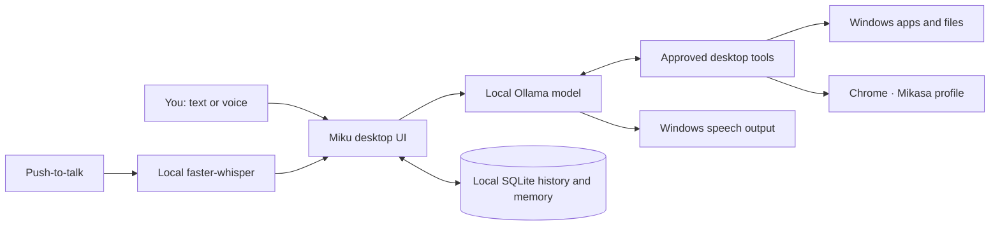

<p align="center">
  
</p>

<p align="center">
  
</p>

<p align="center">
  
  
  
  
</p>

<p align="center"><b>A focused, keyboard-first desktop assistant that runs its AI locally.</b><br />Chat, speak, launch apps, inspect windows, and work with files from one clean dark interface.</p>

---

## ✦ What Miku can do

| 💬 Chat | 🎙️ Speak | 🖥️ Act | 🧠 Remember |
|:--|:--|:--|:--|
| Talk to local Ollama models in a persistent chat | Push to talk with local Whisper transcription; hear replies through Windows speech | Launch apps, inspect and switch windows, take screenshots, and use keyboard or mouse tools | Keep chat history and explicit memories in a local SQLite database |

- **Fast to reach:** press **Ctrl + J** from anywhere; Miku's listener starts Ollama if needed, then opens or focuses Miku.
- **Made for a real desktop:** choose between Qwen 2.5 7B, Qwen 3.5 2B, and a Qwen Coder model.
- **Responsive while thinking:** keep typing while a reply is generating; the next prompt waits in a queue.
- **Google in your Chrome profile:** searches open in the Chrome profile named **Mikasa**. Chrome protects its regular profile from automated page reading, so Miku opens results for you to inspect instead of claiming to summarize them.
- **Local by default:** model inference, voice recognition, chat history, and memory stay on your PC. A Google search sends its query to Google.

## ✨ Quick start

### Requirements

- Windows 11
- Python 3.13
- [Ollama for Windows](https://ollama.com/download)
- At least one supported model pulled into Ollama

### Install and run

```powershell
git clone https://github.com/shivubuilds-mikasa/MIKU.git
cd MIKU
py -3.13 -m venv .venv
.\.venv\Scripts\Activate.ps1
python -m pip install --upgrade pip
pip install -r requirements.txt
python main.py
```

The default model is `qwen2.5:7b`. If it is not installed yet:

```powershell
ollama pull qwen2.5:7b
```

For a lighter model, pull `qwen3.5:2b` and choose it from Miku's model menu. The first voice-input session may download the local Whisper `base` model.

### Enable Ctrl + J

Run `Install Miku Hotkey.ps1` once from the project folder. It creates a per-user Startup shortcut; it does not install a service or require administrator rights. To add a Desktop shortcut, run `Create Miku Shortcut.ps1`.

## 🎨 Interface preview

Miku uses a dark, low-clutter layout: recent chats on the left, conversation in the center, and a compact composer with voice, speech, and send controls.

<p align="center"><sub>Animated header and typing text are rendered by the linked SVG services above; the app itself stays lightweight and native to Windows.</sub></p>

## 🧭 How it fits together



## 🔒 Privacy and safeguards

- No cloud model fallback. Normal inference stays on the local Ollama endpoint.
- File operations are restricted to Documents, Desktop, Downloads, and the Miku project. Reads are capped at 1 MB; overwrites create a backup.
- There is no shell-execution, delete-file, email, or password-manager tool.
- Miku asks before high-impact actions such as sending, submitting, publishing, or buying. Review each approval prompt before accepting it.
- Chrome searches use the selected Mikasa profile and send the query to Google. Miku does not inspect password stores or claim to read pages from Chrome's protected main profile.
- Voice capture is six seconds in memory and transcription is local. Miku does not intentionally save audio.

See [SECURITY.md](SECURITY.md) for details and limits.

## 🗂️ Project map

```text
MIKU/
├── main.py                 # Single-instance desktop app entry point
├── miku/                    # UI, local agent, tools, and SQLite memory
├── miku_hotkey.py           # Per-user Ctrl+J listener
├── tests/                   # Integration checks
├── requirements.txt         # Pinned Python dependencies
├── Launch Miku.bat          # Direct launcher
└── *.md                     # Setup, architecture, security, troubleshooting
```

Runtime data is created in `data/` and is intentionally excluded from Git.

## 🛠️ Configuration

Miku reads these optional environment variables:

| Variable | Default | Purpose |
|:--|:--|:--|
| `MIKU_MODEL` | `qwen2.5:7b` | Initial Ollama model |
| `MIKU_OLLAMA_URL` | `http://localhost:11434` | Local Ollama API endpoint |

The previous `JARVIS_MODEL` and `JARVIS_OLLAMA_URL` names remain supported for existing installations.

## 📚 More

- [Installation details](INSTALLATION.md)
- [Architecture](ARCHITECTURE.md)
- [Security notes](SECURITY.md)
- [Troubleshooting](TROUBLESHOOTING.md)

<p align="center">
  
</p>
